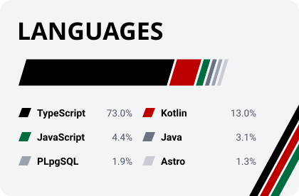

<picture>
  <source media="(prefers-color-scheme: dark)" srcset="./assets/hero-dark.svg?c6" />
  
</picture>

**Levi Opunga**, full-stack engineer in Kenya. I build mobile, web, desktop and backend software, including [TumaBoda](https://tumaboda.co.ke) same-day delivery, the Tessera SSH client, the Linky device-linking app, M-Pesa payments and KRA eTIMS tax filing. Find me on X at [@badAtVim](https://twitter.com/badAtVim).

<picture>
  <source media="(prefers-color-scheme: dark)" srcset="./assets/intro-dark.svg?c7" />
  
</picture>

<picture>
  <source media="(prefers-color-scheme: dark)" srcset="./assets/building-dark.svg?c6" />
  
</picture>

<a href="https://tumaboda.co.ke">
  <picture>
    <source media="(prefers-color-scheme: dark)" srcset="./assets/project-tumaboda-dark.svg?c6" />
    
  </picture>
</a>

<picture>
  <source media="(prefers-color-scheme: dark)" srcset="./assets/project-tsavosync-dark.svg?c6" />
  
</picture>

  <picture>
    <source media="(prefers-color-scheme: dark)" srcset="./assets/project-tessera-dark.svg?c6" />
    
  </picture>
  <picture>
    <source media="(prefers-color-scheme: dark)" srcset="./assets/project-linky-dark.svg?c6" />
    
  </picture>

  <picture>
    <source media="(prefers-color-scheme: dark)" srcset="./assets/project-convo-hub-dark.svg?c6" />
    
  </picture>
  <picture>
    <source media="(prefers-color-scheme: dark)" srcset="./assets/project-multi-store-commerce-dark.svg?c6" />
    
  </picture>

  <picture>
    <source media="(prefers-color-scheme: dark)" srcset="./assets/project-rent-and-tax-dark.svg?c6" />
    
  </picture>
  <picture>
    <source media="(prefers-color-scheme: dark)" srcset="./assets/project-on-device-ai-dark.svg?c6" />
    
  </picture>

<picture>
  <source media="(prefers-color-scheme: dark)" srcset="./assets/numbers-dark.svg?c6" />
  
</picture>

  <picture>
    <source media="(prefers-color-scheme: dark)" srcset="./metrics.stats-dark.svg" />
    
  </picture>
  <picture>
    <source media="(prefers-color-scheme: dark)" srcset="./metrics.languages-dark.svg" />
    
  </picture>

<picture>
  <source media="(prefers-color-scheme: dark)" srcset="https://raw.githubusercontent.com/Levi-Opunga/Levi-Opunga/output/snake-dark.svg" />
  
</picture>

<picture>
  <source media="(prefers-color-scheme: dark)" srcset="./assets/stack-dark.svg?c6" />
  
</picture>

<a href="https://twitter.com/badAtVim">
  <picture>
    <source media="(prefers-color-scheme: dark)" srcset="./assets/footer-dark.svg?c6" />
    
  </picture>
</a>
